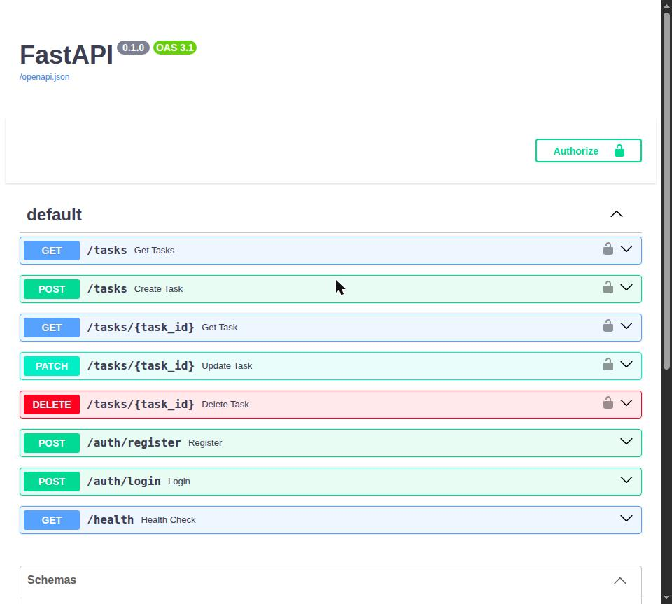

# MindFlow

> Um backend pronto para produção de uma plataforma de produtividade pensada primeiro para pessoas com TDAH, construído com FastAPI, PostgreSQL, autenticação JWT, Docker e publicado na Railway.


## Demonstração ao vivo

🌐 **API em produção**  
https://mindflow-production-5b68.up.railway.app

📖 **Documentação Swagger**  
https://mindflow-production-5b68.up.railway.app/docs



> **Observação:** o banco de dados roda no plano gratuito do Supabase, que pausa projetos após um período de inatividade. Se a API em produção retornar erro 502, o banco provavelmente está pausado: restaure-o no painel do Supabase e faça um novo deploy na Railway.

### Coleção do Postman

Uma coleção do Postman pronta para uso está em [`docs/postman/MindFlow.postman_collection.json`](docs/postman/MindFlow.postman_collection.json).

Importe no Postman (**Import** → selecione o arquivo). Ela cobre:
- `GET /health` com um teste automatizado de status
- `POST /auth/register` e `POST /auth/login` (o token é salvo automaticamente em uma variável da coleção)
- Rotas protegidas: `GET /tasks` e `POST /tasks` usando o Bearer token salvo

Use seu próprio e-mail e senha de teste nas requisições Register e Login.

---

## Tecnologias

| Categoria | Tecnologia |
|----------|------------|
| Linguagem | Python |
| Framework | FastAPI |
| ORM | SQLAlchemy |
| Banco de dados | PostgreSQL (Supabase) |
| Autenticação | JWT + bcrypt |
| Containerização | Docker |
| Deploy | Railway |

---

## Funcionalidades

- Autenticação com JWT
- Hash seguro de senhas com bcrypt
- Cadastro e login de usuários
- Tarefas pertencentes a cada usuário (ownership)
- CRUD completo de tarefas (criar, ler, atualizar, excluir)
- Persistência em PostgreSQL
- Ambiente de desenvolvimento com Docker
- Deploy em produção na Railway

---

## Arquitetura

```
Cliente
   │
   ▼
Autenticação JWT
   │
   ▼
FastAPI
   │
   ▼
SQLAlchemy
   │
   ▼
PostgreSQL (Supabase)
```

---

## Endpoints da API

### Autenticação

| Método | Endpoint |
|---------|----------|
| POST | `/auth/register` |
| POST | `/auth/login` |

### Saúde

| Método | Endpoint | Descrição |
|--------|----------|-----------|
| GET | `/health` | Verifica se a API está no ar |

### Tarefas

| Método | Endpoint | Descrição | Autenticação |
|--------|----------|-----------|--------------|
| POST | `/tasks` | Cria uma nova tarefa | ✅ |
| GET | `/tasks` | Lista as tarefas do usuário autenticado | ✅ |
| GET | `/tasks/{task_id}` | Retorna uma tarefa específica | ✅ |
| PATCH | `/tasks/{task_id}` | Atualiza parcialmente uma tarefa | ✅ |
| DELETE | `/tasks/{task_id}` | Exclui uma tarefa | ✅ |

---

## Rodando localmente

Requisitos:

- Docker
- Docker Compose

Clone o repositório:

```bash
git clone https://github.com/guilherme0311-23/MindFlow.git
cd MindFlow
```

Crie um arquivo `.env`:

```env
DATABASE_URL=sua_string_de_conexao_postgres
SECRET_KEY=sua_chave_secreta_jwt
```

Execute:

```bash
docker compose up --build
```

API disponível em:
http://localhost:8000

Swagger:
http://localhost:8000/docs

---

# Sobre

O MindFlow é, ao mesmo tempo, um produto real e um projeto de portfólio de engenharia de backend.

Ele é construído por uma pessoa com TDAH, para pessoas com TDAH. Cada decisão de produto reflete essa perspectiva: onboarding com pouco atrito, uma tarefa visível por vez e tomada de decisão assistida por IA, em vez de gamificação superficial.

Este repositório contém o backend responsável por autenticação, gerenciamento de tarefas, autorização e armazenamento persistente.

---

# Estudo de caso de segurança

Uma das lições mais valiosas deste projeto aconteceu depois do deploy.

Ao testar a API em produção com duas contas de usuário reais, descobri uma falha crítica de segurança.

O endpoint responsável por listar tarefas retornava recursos pertencentes a qualquer usuário autenticado.

A autenticação respondia corretamente:

> "Quem é o usuário?"

Mas a aplicação nunca respondia:

> "Este recurso pertence a este usuário?"

Essa é uma vulnerabilidade clássica de **IDOR (Insecure Direct Object Reference, ou Referência Direta Insegura a Objeto)**.

## Causa raiz

O modelo `Task` não tinha nenhuma relação com o seu dono.

## Solução

- Adicionei `owner_id` como chave estrangeira referenciando `users.id`
- A propriedade é sempre derivada de `current_user.id`
- O cliente nunca controla o `owner_id`
- Toda consulta de tarefas é filtrada pelo dono autenticado

---

## Auditoria de segurança

Depois de corrigir o problema, todos os endpoints que acessam recursos por ID foram auditados.

Resultados:

✅ `GET /tasks`

✅ `GET /tasks/{task_id}`

✅ `POST /tasks`

✅ `PATCH /tasks/{task_id}`

✅ `DELETE /tasks/{task_id}`

✅ Rotas de autenticação (não se aplica)

O mesmo padrão de ownership, filtrando por `owner_id == current_user.id` e retornando 404 (nunca 403) quando o recurso não pertence a quem fez a requisição, foi validado em todo o CRUD, incluindo as operações de atualização e exclusão adicionadas depois da auditoria inicial. Cada rota foi testada manualmente com duas contas de usuário reais para confirmar que um usuário nunca consegue ler, modificar ou excluir as tarefas de outro.

Nenhuma vulnerabilidade de ownership restante foi encontrada.

Encontrar, corrigir e auditar essa vulnerabilidade faz parte do processo de engenharia, não é algo a esconder. Este repositório documenta, de propósito, tanto o erro quanto a solução.

## Da correção manual à proteção permanente

A correção acima eliminou a vulnerabilidade no nível do código: o `owner_id` agora é sempre derivado de `current_user.id`, nunca do cliente. Mas uma correção manual só protege o código como ele existe *hoje*. Ela não impede que o mesmo erro seja reintroduzido no mês que vem, por mim ou por qualquer pessoa que mexa neste código.

Então a correção virou um **teste**, e não apenas um remendo.

O `test_ownership.py` (parte da suíte automatizada abaixo) cria dois usuários independentes, faz cada um criar uma tarefa e verifica que nenhum dos dois consegue fazer `GET`, `PATCH` ou `DELETE` no recurso do outro: toda tentativa entre usuários deve retornar `404`. Não é um teste que verifica se a funcionalidade funciona. É um teste que verifica que a *vulnerabilidade não volta*.

Esse teste agora roda automaticamente via **GitHub Actions** a cada push (veja o selo no topo deste README). Na prática, isso já valeu a pena: ao montar o pipeline, ele pegou uma divergência de dependências no `requirements.txt` e um bug de inicialização (código que só funcionava porque rodava no momento do import, e não no momento da requisição). Os dois eram invisíveis localmente e foram pegos antes de chegar à produção.

Uma correção de segurança sem teste de regressão é um palpite sobre o futuro.
Uma correção de segurança *com* teste é uma garantia.

---

# Roadmap

| Etapa | Status |
|--------|--------|
| Base do backend | ✅ |
| Autenticação JWT | ✅ |
| Docker | ✅ |
| Deploy na Railway | ✅ |
| Auditoria de segurança | ✅ |
| CRUD completo | ✅ |
| Testes automatizados (pytest) | ✅ |
| CI/CD (GitHub Actions) | ✅ |
| Landing Page | ⏳ |

---

# Autor

**Guilherme Dias Lemos**

Estudante de Sistemas de Informação, apaixonado por engenharia de backend, arquitetura de software e por construir aplicações do mundo real documentando o processo de aprendizado.
